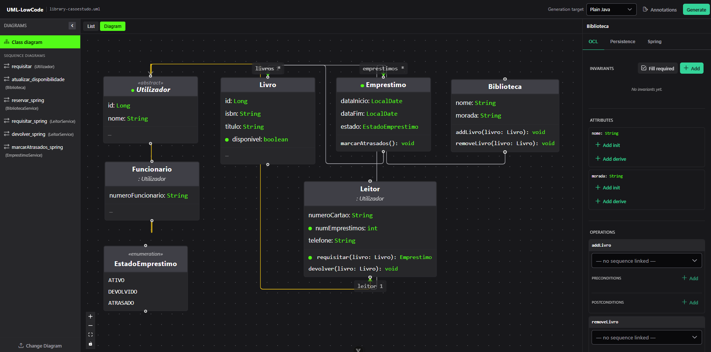
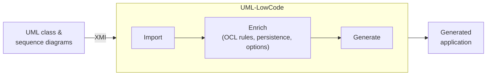

# UML-LowCode

> A low-code tool that turns **UML class and sequence diagrams** into **functional applications**.




## About

This tool takes a UML model exported from Visual Paradigm (in XMI format, using the UML2 export option),
which you then enrich with annotations: extra information like rules expressed in OCL and
persistence options that basic UML diagrams alone don't describe. The tool uses this to generate the source code of
the selected target app. 



### Generation targets

| Target     | Description                                              |
|------------|----------------------------------------------------------|
| `plain`    | Plain Java classes                                       |
| `cli`      | Command-line application, in-memory                      |
| `cli-jpa`  | Command-line application with JPA/H2 persistence         |
| `spring`   | Spring Boot REST application (JPA, H2, DTOs, validation) |

---

## How to use

### Run with Docker


```bash
docker compose up --build
```

Then open **http://localhost:8081** — the backend serves the UI (from `resources/static`).

> To change the port, edit the left side of the mapping in
> `docker-compose.yml` (`"8081:8081"` -> host:container) — nothing else needs to change.

### Local

**1. Install SDMetrics**

```bash
mvn install:install-file \
  -Dfile=generator/lib/sdmetrics.jar \
  -DgroupId=com.sdmetrics -DartifactId=sdmetrics \
  -Dversion=3.0-opencore -Dpackaging=jar
```

**2. Build the generator** (the backend depends on it, so build it first)

```bash
cd generator
mvn clean install
```

**3. Run the backend** — starts on **http://localhost:8081**

```bash
cd tool-backend
mvn spring-boot:run
```

**4. Run the frontend** — starts on **http://localhost:5173**

```bash
cd tool-frontend
npm install
npm run dev
```

## Project structure

```
UML-LowCode/
├── generator/        # the code generator (used as library)
├── tool-backend/     # Spring Boot backend that wraps the generator
└── tool-frontend/    # Vue frontend (upload XMI, annotate, generate)
```

## License

This project is licensed under the [MIT License](LICENSE).

It uses [SDMetrics Open Core](https://www.sdmetrics.com/OpenCore.html), which is licensed under the
**GNU AGPL** (see `SDMetricsOpenCore/agpl.txt`), for parsing UML/XMI models.
